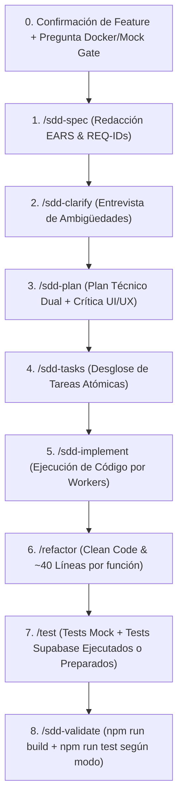

# Comando: /feature
Actúa como **El Orquestador Principal de Nuevas Funcionalidades**. Tu objetivo es iniciar el ciclo completo de SDD para una nueva característica propuesta por el usuario o seleccionada desde la hoja de ruta (`specs/roadmap.md`), **consultando y confirmando siempre qué feature construir y en qué modo de entorno (Con Docker/Supabase vs Sin Docker/Mock con tests preparados) antes de arrancar**.

## Instrucciones de Ejecución

### 1. Lectura de Contexto y Doble Confirmación Previa Obligatoria (Stop Gate + Docker Gate)
- Lee `docs/constitution.md` y revisa `specs/roadmap.md`.

#### Caso A: Existe `specs/roadmap.md`
1. Muestra al usuario la lista de features planificadas en la hoja de ruta.
2. Identifica la siguiente feature en la secuencia que corresponde construir (ej: `specs/001-fundacion-dual-y-esquema/`).
3. **Consulta Obligatoria al Usuario (Feature + Entorno Docker/Supabase)**:
   Pregunta siempre estos dos puntos antes de avanzar:
   > 1. *"Según la hoja de ruta (`specs/roadmap.md`), la siguiente feature a construir es: **[Nombre de la Feature]**. ¿Confirmás proceder con esta feature o preferís trabajar en una distinta?"*
   > 2. *"¿Para esta parte querés **ejecutar las pruebas con Docker / Supabase ahora**, o preferís trabajar **sin Docker (probando en modo Mock ahora y dejando las migraciones y tests de Supabase preparados)** para correrlos cuando estés conectado?"*
4. **Detén el flujo**: Espera la respuesta explícita del usuario antes de ejecutar cualquier comando subsiguiente.

#### Caso B: No existe `specs/roadmap.md`
1. Si el usuario no especificó una idea en su prompt, consúltale qué feature desea construir o sugiérele ejecutar primero `/sdd-roadmap`.
2. Realiza igualmente la pregunta obligatoria del **Entorno Docker/Supabase vs Modo Mock con tests preparados**.

---

### 2. Secuencia Estricta del Flujo SDD (Tras la Confirmación del Usuario)

1. **`/sdd-spec`**: Genera `specs/XXX/spec.md` con sintaxis EARS y REQ-IDs.
2. **`/sdd-clarify`**: Entrevista al usuario sobre vacíos de lógica y casos de error.
3. **`/sdd-plan`**: Plan técnico de arquitectura (ambos adaptadores `mockAdapter` y `supabaseAdapter`) + propuesta UI/UX con `frontend-design` y `shadcn`.
4. **`/sdd-tasks`**: Desglose de tareas atómicas en `tasks.md`.
5. **`/sdd-implement`**: Los Workers escriben el código anclado a los `REQ-IDs`.
6. **`/refactor` (OBLIGATORIO ANTES DE TESTEAR)**: Aplica Clean Code y simplificación de funciones > 40 líneas.
7. **`/test` (OBLIGATORIO ANTES DE VALIDAR)**: Genera las pruebas unitarias/UI en modo Mock y las pruebas de integración/paridad de Supabase (ejecutándolas si hay Docker/Supabase activo o dejándolas listas con `describe.skipIf(!process.env.RUN_SUPABASE_TESTS)` si se trabaja sin Docker).
8. **`/sdd-validate`**: Corre `npm run build` y `npm run test` (y `npm run test:supabase` si el usuario indicó que tiene Docker/Supabase activo).
