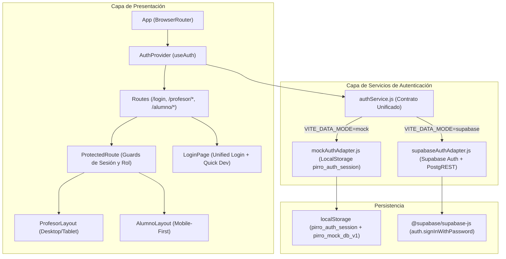

# Plan Técnico y Arquitectura: 002 — Autenticación Unificada, Roles y Layouts Protegidos

## 1. Dirección Visual y Diseño UI/UX (`frontend-design` + `shadcn`)

### 1.1 Identidad Visual y Estilo Deportivo de Alto Rendimiento
Siguiendo los lineamientos de la Constitución (Sección III) y la paleta aprobada en el módulo fundacional:
- **Tema Oscuro Principal**: Negro Carbón (`#111418`), Gris Pizarra (`#1B2026`), Acentos en Turquesa Intenso (`#00C2CB`), Borde Plateado Cepillado (`#323B46`).
- **Tema Claro Alternativo**: Gris Plata Claro (`#E5E9EC`), Paneles Perla (`#F4F6F8`), Acento Turquesa Profundo (`#008B94`).

### 1.2 Layout del Profesor (`ProfesorLayout`)
- **Diseño**: Orientado a productividad en escritorio y tableta, adaptable a móviles.
- **Header**: Barra superior con logotipo / isotipo de Pirro-System, nombre `Prof. Leandro Pirro`, badge de rol `PROFESOR`, toggle de tema y botón de desconexión.
- **Sidebar**: Navegación lateral persistente en escritorio (`w-64`) con iconos (`Dashboard`, `Gimnasios`, `Ejercicios`, `Alumnos`, `Rutinas`, `Progreso`). En móvil se convierte en menú colapsable (drawer/hamburguesa).
- **Acceso Directo**: Enlace al Tablero Fundacional / Dev Mode para verificar el estado del sistema.

### 1.3 Layout del Alumno (`AlumnoLayout` 100% Mobile-First)
- **Diseño**: Diseñado estrictamente para sostener el celular con una sola mano en el gimnasio (ergonomía de pulgar).
- **Header Compacto**: Saludo (`"Hola, Martín"`), sede asignada (`"Iron Temple Palermo"`), toggle de tema y botón discreto de salida.
- **Bottom Navigation**: Barra inferior fija (`fixed bottom-0 left-0 right-0 z-40 bg-card border-t border-border`):
  - Botones táctiles de gran tamaño (`min-h-14`, target táctil `>= 48px`).
  - Accesos:
    1. **Entrenar** (Icono `Dumbbell`) -> `/alumno` (Planilla del día).
    2. **Rutinas** (Icono `CalendarDays`) -> `/alumno/rutinas` (Ver días y ejercicios).
    3. **Historial** (Icono `History`) -> `/alumno/historial` (Series y pesos previos).
    4. **Perfil** (Icono `User`) -> `/alumno/perfil` (Datos físicos y gimnasio).
  - Espacio de seguridad inferior (`pb-20`) en el contenedor principal para evitar solapamientos.

---

## 2. Arquitectura de Software y Capa de Datos Dual



---

## 3. Estructura de Archivos a Crear y Modificar

```text
workspace/
├── supabase/
│   └── migrations/
│       └── 20261009000001_auth_helpers.sql            # [REQ-AUTH-015] Función SQL resolve_user_email_by_identifier
│
└── frontend/src/
    ├── app/                                           # [REQ-AUTH-006..011]
    │   ├── AppRoutes.jsx                              # Definición central de rutas y redirecciones
    │   ├── layouts/
    │   │   ├── ProfesorLayout.jsx                     # Layout de gestión del profesor
    │   │   ├── AlumnoLayout.jsx                       # Layout móvil táctil del alumno
    │   │   ├── ProfesorSidebar.jsx                    # Barra lateral / drawer del profesor
    │   │   └── AlumnoBottomNav.jsx                    # Barra de navegación inferior del alumno
    │   └── routes/
    │       └── ProtectedRoute.jsx                     # Guard de autenticación y rol
    │
    ├── features/
    │   └── auth/                                      # [REQ-AUTH-001..006, 012]
    │       ├── context/
    │       │   └── AuthContext.jsx                    # Provider y hook useAuth()
    │       ├── components/
    │       │   ├── LoginPage.jsx                      # Página completa de Login
    │       │   ├── LoginForm.jsx                      # Formulario unificado email/username
    │       │   └── DevQuickLogin.jsx                  # Botones demo de 1 clic (DEV)
    │       └── pages/
    │           ├── ProfesorHome.jsx                   # Dashboard inicial del profesor
    │           ├── AlumnoHome.jsx                     # Home mobile-first del alumno
    │           └── UnauthorizedPage.jsx               # Vista de acceso denegado / deshabilitado
    │
    ├── services/
    │   ├── authService.js                             # [REQ-AUTH-002] Fachada dual de autenticación
    │   └── adapters/
    │       ├── mockAuthAdapter.js                     # Adaptador Mock persistido en localStorage
    │       └── supabaseAuthAdapter.js                 # Adaptador Supabase Auth
    │
    └── tests/
        ├── authService.test.js                        # Tests unitarios del servicio de auth y paridad
        ├── ProtectedRoute.test.jsx                    # Tests de protección de rutas y redirección
        ├── LoginForm.test.jsx                         # Tests del formulario y quick buttons
        ├── Layouts.test.jsx                           # Tests de renderizado de layouts Profesor y Alumno
        └── authAdapter.supabase.test.js               # Tests de integración Supabase (skipIf)
```

---

## 4. Contrato de Autenticación (`AuthContract`)

Tanto `mockAuthAdapter` como `supabaseAuthAdapter` satisfacen estrictamente la interfaz:
```typescript
interface AuthUser {
  id: number
  id_usuario: number
  id_persona: number
  nombre_usuario: string
  email: string
  rol: 'profesor' | 'alumno'
  nombre: string
  apellido: string
  url_foto: string | null
  id_gimnasio?: number
  nombre_gimnasio?: string
}

interface AuthSession {
  token: string
  expiresAt: string
}

interface AuthResult {
  ok: boolean
  user?: AuthUser
  session?: AuthSession
  error?: {
    code: 'INVALID_CREDENTIALS' | 'ACCOUNT_INACTIVE' | 'NETWORK_ERROR'
    message: string
  }
}
```
