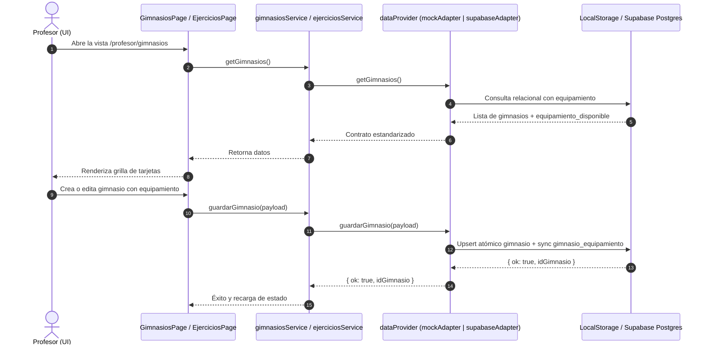

# Plan Técnico y Arquitectura: 003 — ABM de Gimnasios, Equipamiento y Catálogo de Ejercicios

## 1. Diseño Visual y Experiencia UI/UX (`frontend-design` + `shadcn`)

### 1.1 Vistas del Panel del Profesor

1. **Gestión de Sedes y Gimnasios (`/profesor/gimnasios`)**:
   - **Header de Sección**: Título "Sedes y Gimnasios", subtítulo explicativo y botón principal de acción `+ Nueva Sede`.
   - **Grilla de Sedes**:
     - Cada tarjeta muestra nombre del gimnasio, estado operativo (`Activo` en verde / `Inactivo` en gris), dirección (`MapPin`), horario comercial (`Clock`) y badge de cantidad de equipamientos disponibles.
     - Botón de edición rápida (icono lápiz) y botón de baja lógica / reactivación.
   - **Modal de Sede (`GimnasioFormModal`)**:
     - Formulario accesible con validación en vivo.
     - Campos: Nombre (obligatorio), Dirección, Horario Apertura y Cierre.
     - Sección de selección de equipamiento: Listado categorizado (`Máquinas`, `Peso Libre`, `Accesorios`, `Cardio`) con checkboxes para asociar elementos disponibles en la sede.

2. **Catálogo de Ejercicios (`/profesor/ejercicios`)**:
   - **Barra de Herramientas**:
     - Buscador por texto con icono de lupa (filtra por nombre en tiempo real).
     - Carrusel horizontal de chips / badges para filtrar por grupo muscular: *Todos, Pectorales, Espalda, Cuádriceps, Isquiotibiales, Glúteos, Hombros, Bíceps, Tríceps, Core*.
     - Botón `+ Nuevo Ejercicio`.
   - **Tarjetas de Ejercicio**:
     - Nombre destacado, chip de grupo muscular.
     - Indicador visual claro si requiere equipamiento específico (ej: `"Requiere: Rack de Sentadilla"`).
     - Sección desplegable con notas técnicas de ejecución.
     - Botón externo para abrir el video instructivo (`url_video`) si está configurado.
   - **Modal de Ejercicio (`EjercicioFormModal`)**:
     - Nombre y selector de grupo muscular.
     - Switch interactivo: "¿Requiere máquina o equipamiento específico?".
     - Si está activo, despliega un combobox con las máquinas y elementos del catálogo maestro.
     - Campo de texto para indicaciones y sugerencias para el alumno.
     - Campo opcional para link de video (YouTube / Vimeo).

---

## 2. Diagrama de Flujo y Arquitectura Dual



---

## 3. Estructura de Archivos a Crear y Modificar

```text
workspace/frontend/src/
├── features/
│   ├── gimnasios/
│   │   ├── components/
│   │   │   ├── GimnasiosPage.jsx                      # [REQ-GYM-006] Vista principal de gimnasios
│   │   │   ├── GimnasioCard.jsx                       # Tarjeta individual con badges y acciones
│   │   │   └── GimnasioFormModal.jsx                  # Modal de alta/edición y asignación de máquinas
│   │   └── hooks/
│   │       └── useGimnasios.js                        # Hook con estado y operaciones CRUD
│   │
│   └── ejercicios/
│       ├── components/
│       │   ├── EjerciciosPage.jsx                     # [REQ-EJE-006] Vista del catálogo con filtros
│       │   ├── EjercicioCard.jsx                      # Tarjeta con grupo muscular, video y notas
│       │   └── EjercicioFormModal.jsx                 # Modal de alta/edición con switch condicional
│       └── hooks/
│           └── useEjercicios.js                       # Hook con filtros de búsqueda y operaciones
│
├── services/
│   ├── gimnasiosService.js                            # [REQ-GYM-001..005] Fachada dual de gimnasios
│   ├── ejerciciosService.js                           # [REQ-EJE-001..005] Fachada dual de ejercicios
│   ├── validators/
│   │   ├── gimnasiosValidator.js                      # Validación de datos de gimnasio
│   │   └── ejerciciosValidator.js                     # Validación de datos de ejercicio
│   └── adapters/
│       ├── mockAdapter.js                             # Extensión con CRUD completo de gimnasios y ejercicios
│       └── supabaseAdapter.js                         # Extensión con consultas SQL/PostgREST para rol profesor
│
└── tests/
    ├── gimnasiosService.test.js                       # Tests unitarios del servicio de gimnasios (Mock)
    ├── ejerciciosService.test.js                      # Tests unitarios del servicio de ejercicios (Mock)
    ├── GimnasiosPage.test.jsx                         # Tests de renderizado e interacción de gimnasios
    ├── EjerciciosPage.test.jsx                        # Tests de filtros y formularios de ejercicios
    └── gimnasiosEjercicios.supabase.test.js           # Tests de integración en vivo contra Supabase Docker
```
