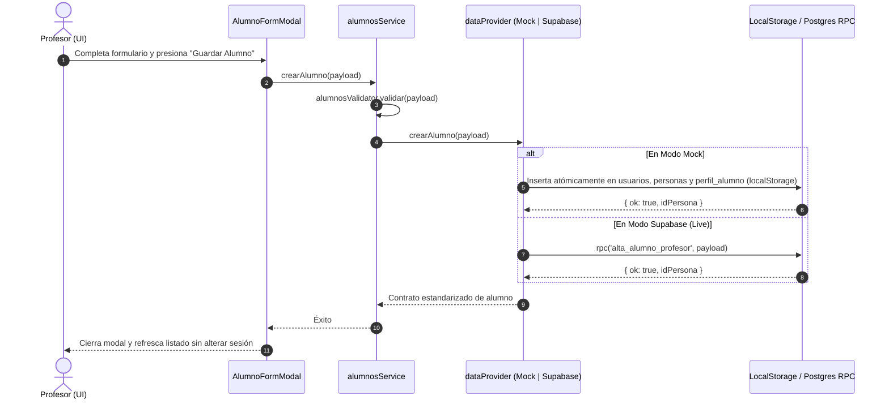

# Plan Técnico y Arquitectura: 004 — ABM de Alumnos y Ficha Física/Médica

## 1. Diseño Visual y Experiencia UI/UX (`frontend-design` + `shadcn`)

### 1.1 Vista del Panel del Profesor (`/profesor/alumnos`) — REQ-ALU-007
- **Header de Gestión**:
  - Título deportivo "Gestión de Alumnos", subtítulo indicando cantidad de alumnos activos y botón primario destacado `+ Nuevo Alumno` con micro-animación y modal ágil.
- **Barra de Filtros y Búsqueda**:
  - Buscador en tiempo real con icono de lupa (búsqueda por nombre, apellido, email o nombre de usuario).
  - Selector desplegable de Gimnasio/Sede (Todos los gimnasios, Sede específica, Sin sede asignada).
  - Segmented control / Tabs para estado: `Activos` (default), `Inactivos`, `Todos`.
- **Grilla de Tarjetas "Ficha de Atleta"**:
  - Tarjetas con borde sutil, avatar o iniciales con contraste deportivo (`bg-primary/20 text-primary font-bold`).
  - Nombre completo destacado y nombre de usuario (@usuario).
  - Badge de sede asignada con icono de ubicación y badge de `X días/sem`.
  - Indicador rápido de alerta médica: badge discreto en ámbar `Atención Médica` si registra antecedentes en `salud_enfermedades`.
  - Botonera rápida de acción:
    - Enlace táctil a WhatsApp (abrir chat con teléfono registrado).
    - Botón `Ver Ficha` (despliega modal de ficha física y médica).
    - Botón `Editar` (abre modal de edición de datos y ficha).
    - Menú o botón para alternar baja lógica (`Desactivar` / `Reactivar`).

### 1.2 Modal de Ficha Física y Médica (`FichaMedicaModal`) — REQ-ALU-008
- **Encabezado con Identidad del Alumno**: Nombre completo, fecha de nacimiento, edad calculada y fecha de ingreso al entrenamiento.
- **Sección de Alerta Médica**:
  - Si registra antecedentes: Card destacada con borde ámbar/rojo, icono de alerta (`AlertTriangle`), y detalle claro de patologías, cirugías, dolores o lesiones previas.
  - Si no registra antecedentes: Card verde suave con icono `CheckCircle` indicando "Sin patologías declaradas".
- **Métricas Antropométricas Destacadas**:
  - Grid de 3 cajas de métricas: Peso ($kg$), Altura ($cm$) e Índice de Masa Corporal orientativo (IMC calculado automáticamente con categorización).
- **Detalle de Entrenamiento y Observaciones**:
  - Sede asignada, días semanales y cuadro de notas pedagógicas y objetivos del profesor (`comentario`).

### 1.3 Modal de Alta y Edición de Alumno (`AlumnoFormModal`) — REQ-ALU-002, REQ-ALU-003, REQ-ALU-004
- Formulario organizado en 3 bloques lógicos con navegación fluida:
  1. **Datos de Acceso e Identidad**: Nombre, apellido, email, nombre de usuario (DNI o alias), teléfono y contraseña (con valor predeterminado `'Pirro123!'` editable).
  2. **Asignación de Sede y Frecuencia**: Selector de gimnasio (opcional) y selector de días semanales de rutina (1 a 7).
  3. **Ficha Física y Antecedentes Médicos**: Altura, peso, fecha de nacimiento, fecha de ingreso, patologías/enfermedades previas y observaciones pedagógicas.

### 1.4 Vista de Ficha Personal del Alumno (`/alumno/perfil`) — REQ-ALU-009
- Diseño 100% Mobile-First:
  - Tarjeta de perfil con avatar y bienvenida al alumno.
  - Métricas corporales personales (peso, altura, días semanales de entrenamiento).
  - Ficha médica personal para su consulta y verificación.
  - Tarjeta de sede con dirección, horarios comerciales y enlace directo a Google Maps o contacto.
  - Información de contacto de su profesor **Leandro Pirro** (teléfono, email, botón para consultar por WhatsApp).

---

## 2. Arquitectura de Datos y Proveedor Dual (`mockAdapter` vs `supabaseAdapter`)

### 2.1 Flujo Secuencial de Alta de Alumno



### 2.2 Migración SQL y Función RPC en Supabase (`workspace/supabase/migrations/`)
- Se crea la migración `20261010000001_alta_alumno_rpc.sql`:
  - Función `public.alta_alumno_profesor(payload jsonb)`:
    - Valida que `auth.uid()` pertenezca a un profesor activo (`public.get_my_role() = 'profesor'`).
    - Valida unicidad de `email` y `nombre_usuario`.
    - Inserta en `public.usuarios`.
    - Inserta en `public.personas` (`rol = 'alumno'`).
    - Inserta en `public.perfil_alumno` con `id_profesor` asociado al profesor invocador.
    - Devuelve JSON `{ ok: true, id_persona: ... }`.

### 2.3 Mapeo de Contrato de Servicio (`alumnosService.js`)
```javascript
// Métodos con paridad estricta entre mockAdapter y supabaseAdapter
alumnosService.getAlumnos(filtros)
alumnosService.getAlumnoById(idPersona)
alumnosService.crearAlumno(alumnoData)
alumnosService.actualizarAlumno(idPersona, alumnoData)
alumnosService.cambiarEstadoAlumno(idPersona, nuevoEstado)
alumnosService.getMiPerfilAlumno()
```

---

## 3. Plan de Modularización y Clean Code (SRP $\le 40$ líneas / función)

1. **Validadores y Utilidades**:
   - `src/services/validators/alumnosValidator.js`: Validaciones defensivas de email, usuario, rango 1-7 días, y números positivos.
   - `src/features/alumnos/utils/alumnoFormatters.js`: Cálculo de edad, cálculo de IMC, formato de teléfono para WhatsApp.

2. **Adaptadores**:
   - `src/services/adapters/mockAdapter.js`: Extensión para operaciones de alumnos con sincronización multi-tabla en `localStorage`.
   - `src/services/adapters/supabaseAdapter.js`: Extensión consumiendo `alta_alumno_profesor` y consultas PostgREST con políticas RLS.
   - `src/services/alumnosService.js`: Fachada unificada sin acoplamiento a clientes concretos.

3. **Hooks de Estado**:
   - `src/features/alumnos/hooks/useAlumnos.js`: Carga, filtrado en cliente, operaciones de alta, edición y baja.
   - `src/features/alumnos/hooks/useAlumnoPerfil.js`: Carga de ficha personal para el alumno logueado.

4. **Componentes Visuales**:
   - `src/features/alumnos/components/AlumnoCard.jsx`: Ficha de Atleta interactiva.
   - `src/features/alumnos/components/FichaMedicaModal.jsx`: Modal de ficha física y médica con advertencias.
   - `src/features/alumnos/components/AlumnoFormModal.jsx`: Modal de alta y edición estructurado en bloques.
   - `src/features/alumnos/components/AlumnosFilterBar.jsx`: Barra de búsqueda, filtro por sede y pestañas de estado.
   - `src/features/alumnos/components/AlumnosPage.jsx`: Vista principal para el profesor (`/profesor/alumnos`).
   - `src/features/alumnos/components/AlumnoPerfilPage.jsx`: Vista Mobile-First para el alumno (`/alumno/perfil`).
