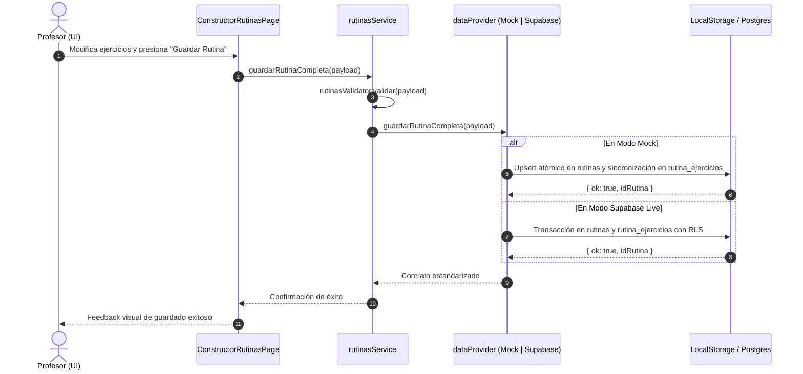

# Plan Técnico y Arquitectura: 005 — Constructor de Rutinas Semanales por Alumno y Día

## 1. Diseño Visual y Experiencia UI/UX (`frontend-design` + `shadcn`)

### 1.1 Vista Principal del Constructor (`/profesor/rutinas`) — REQ-RUT-008
- **Selector de Alumno y Barra de Contexto**:
  - Selector superior con búsqueda rápida de alumnos de la cartera.
  - Al seleccionar un alumno, se despliega una barra de contexto deportivo con:
    - Avatar e iniciales con estilo atlético (`bg-primary/20 text-primary font-bold`).
    - Nombre de la sede habitual asignada (`📍 Iron Temple Palermo` o `Sin sede`).
    - Frecuencia semanal (`⚡ 3 días/sem`).
    - Botón `📋 Ver Ficha Médica` con `cursor-pointer active:scale-95` que abre su ficha médica en un modal para consultar lesiones y objetivos antes de programar los ejercicios.
- **Navegación por Pestañas de Días**:
  - Segmented control / pestañas horizontales (`Día 1`, `Día 2`... hasta `cantidad_dias_rutina`).
  - Cada pestaña muestra el número de día, el nombre temático personalizado y un contador de ejercicios programados (ej: `4 ejerc.`).
- **Encabezado del Día**:
  - Campo editable para el nombre temático del día (ej: *"Día 1: Pectorales & Tríceps"*).
- **Lista Central de Ejercicios del Día**:
  - Tarjetas de ejercicios ordenadas (`orden` 1, 2, 3...) con diseño deportivo:
    - Número de orden destacado en un badge circular (`#1`, `#2`...).
    - Nombre del ejercicio y grupo muscular con badge temático.
    - **Insignia del Asistente de Equipamiento**: Si el ejercicio requiere una máquina que no figura en el gimnasio del alumno, se exhibe un badge destacado en ámbar (`⚠️ Hack Squat no disponible en Sede X`) como aviso preventivo en tiempo real mientras el profesor programa la rutina (sin bloquear la acción).
    - Controles de programación:
      - Campo numérico de `Series` (precargado en `3`, editable).
      - Campo de `Repeticiones` (precargado en `'10-12'`, texto ágil para permitir rangos, biseries o notas).
      - Campo de `Notas del Profesor` (opcional, ej: *"Descanso de 90s, enfoque en fase excéntrica"*).
    - Botonera de control: Flechas arriba/abajo (`⬆️`, `⬇️`) para reordenar la secuencia y botón `🗑️` para quitar.
- **Acciones Principales**:
  - Botón secundario `+ Agregar Ejercicio` que abre el modal de catálogo.
  - Botón primario `💾 Guardar Rutina del Día` con feedback de guardado exitoso y animación.

### 1.2 Modal de Catálogo de Ejercicios (`CatalogoSelectorModal`) — REQ-RUT-009
- Buscador por texto en tiempo real con lupa.
- Chips filtrables por grupo muscular (*Todos, Pectorales, Espalda, Cuádriceps, Isquiotibiales, Glúteos, Hombros, Bíceps, Tríceps, Core, Cardio*).
- Lista de ejercicios donde cada fila muestra:
  - Nombre del ejercicio y badge de músculo.
  - Indicador de máquina/peso libre requerida.
  - Indicador preventivo del asistente: Si la máquina no está en la sede del alumno, se marca en ámbar antes de seleccionarlo.
  - Botón `+ Agregar` que lo añade inmediatamente a la rutina del día con valores predeterminados (3 series de 10-12 repeticiones).

---

## 2. Arquitectura de Datos y Proveedor Dual (`mockAdapter` vs `supabaseAdapter`)

### 2.1 Flujo Secuencial de Guardado de Rutina



### 2.2 Mapeo de Contrato de Servicio (`rutinasService.js`)
```javascript
// Métodos unificados con paridad estricta
rutinasService.getRutinasByAlumno(idAlumno)
rutinasService.guardarRutinaCompleta(payload)
rutinasService.eliminarRutina(idRutina)
```

---

## 3. Plan de Modularización y Clean Code (SRP $\le 40$ líneas / función)

1. **Validadores y Asistente**:
   - `src/services/validators/rutinasValidator.js`: Validación de payload de rutina, días (1-7), series y repeticiones.
   - `src/features/rutinas/utils/equipamientoChecker.js`: Función pura que cruza el `id_equipamiento_requerido` del ejercicio contra los equipamientos disponibles en la sede del alumno.

2. **Adaptadores**:
   - Extensión de `mockAdapter.js`, `mockAdapterQueries.js` y `mockAdapterMutations.js` para `guardarRutinaCompleta`.
   - Extensión de `supabaseAdapter.js` y `supabaseAdapterMutations.js` para `guardarRutinaCompleta`.
   - Fachada unificada `src/services/rutinasService.js`.

3. **Hooks de Estado**:
   - `src/features/rutinas/hooks/useConstructorRutinas.js`: Administra alumno seleccionado, día activo, estado de la rutina del día, agregado/eliminación y reordenamiento.
   - `src/features/rutinas/hooks/useCatalogoSelector.js`: Administra búsqueda, filtrado por músculo y selección de ejercicios.

4. **Componentes Visuales**:
   - `src/features/rutinas/components/ConstructorAlumnoHeader.jsx`: Selector de alumno, badge de sede y botón a ficha médica.
   - `src/features/rutinas/components/ConstructorDiasTabs.jsx`: Pestañas por día de la semana.
   - `src/features/rutinas/components/RutinaEjercicioItem.jsx`: Tarjeta de ejercicio con advertencia de equipamiento, inputs de series/reps y controles de orden.
   - `src/features/rutinas/components/CatalogoSelectorModal.jsx`: Modal de catálogo de ejercicios con asistente de máquinas.
   - `src/features/rutinas/components/ConstructorRutinasPage.jsx`: Vista principal en `/profesor/rutinas`.
