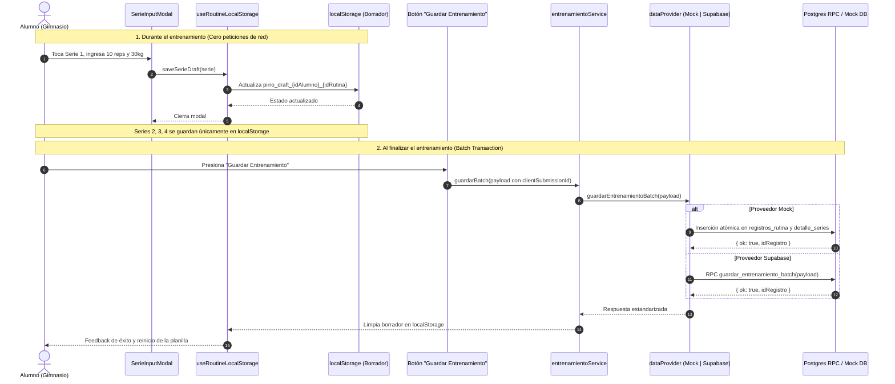

# Plan Técnico y Arquitectura: 006 — Planilla Interactiva Mobile-First, Modal por Serie y Guardado Local Batch (Rol Alumno)

## 1. Diseño Visual y Experiencia Mobile-First (`frontend-design` + `shadcn`)

### 1.1 Vista Principal de Entrenamiento (`/alumno` y `/alumno/rutinas`) — REQ-TRN-001 a REQ-TRN-003
- **Header y Contexto Deportivo**:
  - Saludo al alumno y badge con sede asignada.
  - **Selector de Día de Entrenamiento**: Selector segmentado deslizable horizontalmente con los días asignados (`Día 1: Torso`, `Día 2: Piernas`, etc.).
  - **Selector de Fecha de Realización**: Campo de fecha compacto con formato ISO `YYYY-MM-DD`, precargado con el día de hoy, editable si el alumno entrena un día anterior o posterior.
- **Lista de Ejercicios del Día**:
  - Tarjetas deportivas de alto contraste para cada ejercicio asignado:
    - Encabezado con número de orden (`#1`), nombre del ejercicio y badge de grupo muscular.
    - Notas pedagógicas del profesor visibles en un recuadro de instrucción (`📝 Notas: "Subir 2.5kg si completás las series..."`).
    - **Grilla de Series Objetivo**:
      - Fila de botones táctiles amplios (`min-h-12 min-w-16`) para cada serie (`1` hasta `series_objetivo`).
      - **Estado Pendiente**: Borde sutil, fondo tenue, indicando `S1`, `S2` y las repeticiones objetivo sugeridas (`10 r`).
      - **Estado Completado en Borrador**: Fondo verde/esmeralda esmerilado (`bg-emerald-500/20 text-emerald-400 border-emerald-500/40`), mostrando en tipografía nítida: `10r · 30kg`.
- **Barra Inferior de Guardado Batch (Sticky Footer)**:
  - Barra flotante inferior fija sobre el `AlumnoBottomNav`:
    - Resumen de progreso: `3 / 12 series completadas`.
    - Botón primario de guardado masivo **"Guardar Entrenamiento"** (`min-h-12 w-full font-bold bg-primary text-primary-foreground rounded-xl shadow-lg active:scale-95`).

---

### 1.2 Modal Táctil por Serie (`SerieInputModal`) — REQ-TRN-004 a REQ-TRN-006
- Diseñado para interactuar con una sola mano en el gimnasio:
  - Título con ejercicio y número de serie (ej: *"Press Banca Plana — Serie 2 de 4"*).
  - Badge de referencia con las `repeticiones_objetivo` fijadas por el profesor.
  - **Controles Táctiles Rápidos**:
    - **Repeticiones Realizadas**: Input numérico de gran tamaño con botones de incremento/decremento (`-` / `+`).
    - **Peso Utilizado (kg)**: Input numérico con saltos rápidos (`-2.5`, `+2.5`, `+5`).
    - **Comentario del Alumno (opcional)**: Input de texto para registrar sensaciones (ej: *"Llegué al fallo en la 8va"*).
  - Botón de confirmación rápido **"Confirmar Serie"** que guarda en `localStorage` inmediatamente y cierra el modal en < 100ms.

---

### 1.3 Historial de Entrenamientos (`/alumno/historial`) — REQ-TRN-009
- Listado cronológico de sesiones completadas:
  - Tarjeta por sesión con fecha formateada en español, nombre de la rutina y cantidad total de series realizadas.
  - Acordeón expandible que desglosa los ejercicios ejecutados, las repeticiones y los pesos alcanzados en cada serie con los comentarios del alumno.

---

## 2. Arquitectura de Datos y Sincronización Offline-First

### 2.1 Flujo Secuencial: Cero Red por Serie $\rightarrow$ Lote Atómico Final



---

## 3. Paridad Dual Estricta y Métodos de Servicio (`entrenamientoService`)

### Contratos de Datos:
```typescript
interface SeriePayload {
  idEjercicio: number
  numeroSerie: number
  repeticionesObjetivo: string
  repeticionesRealizadas: number
  pesoUtilizado: number
  comentarioAlumno: string | null
}

interface BatchTrainingPayload {
  clientSubmissionId: string // UUID v4
  idAlumno: number
  idRutina: number
  fechaRealizacion: string // YYYY-MM-DD
  series: SeriePayload[]
}
```

### Métodos en `entrenamientoService.js`:
1. `getRutinasAlumno(idAlumno)`: Obtiene las rutinas activas del alumno con sus ejercicios.
2. `guardarBatch(payload)`: Envía el lote atómico al proveedor activo.
3. `getHistorialAlumno(idAlumno)`: Obtiene los registros históricos con sus series y nombres de ejercicios.
