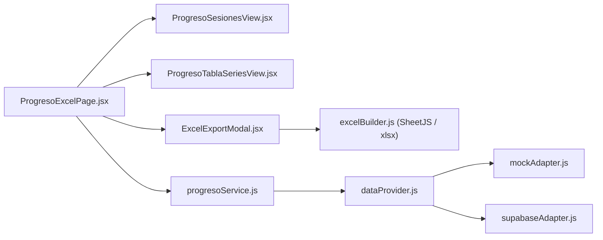

# Plan Técnico y Arquitectura: 007 — Historial de Cargas del Alumno, Seguimiento y Exportación a Excel `.xlsx` (Rol Profesor)

## 1. Diseño Visual y Experiencia UI/UX (`frontend-design` + `shadcn`)

### 1.1 Cabecera y Selector de Alumno (`/profesor/progreso`) — REQ-PRG-001 a REQ-PRG-003
- **Header Deportivo de Alto Contraste**:
  - Título de sección con ícono de analítica/progreso y botón destacado **"Exportar Excel (.xlsx)"** en color esmeralda/primario con ícono de hoja de cálculo (`FileSpreadsheet`).
- **Selector de Alumno + Switch de Inactivos**:
  - Selector desplegable de alumno con indicación de gimnasio asignado y cantidad de días de rutina.
  - Pregunta interactiva mediante checkbox/switch junto al selector: *"¿Incluir alumnos dados de baja (inactivos)?"*. Al activarse, lista también a los alumnos con `estado = false` marcados con `(Inactivo)`.

### 1.2 Barra de Filtros Combinados y KPIs — REQ-PRG-004 a REQ-PRG-005
- **Filtros Reactivos**:
  - `Fecha Desde` (`input[type="date"]`) y `Fecha Hasta` (`input[type="date"]`).
  - `Rutina`: Selector con las rutinas del alumno o `"Todas las rutinas"`.
  - `Ejercicio`: Selector con los ejercicios presentes en las rutinas/historial del alumno o `"Todos los ejercicios"`.
  - Botón rápido `"Limpiar filtros"` cuando hay algún criterio activo.
- **Tarjetas KPI**:
  - 4 tarjetas compactas en grilla: **Sesiones Filtradas**, **Series Totales**, **Récord de Peso (PR en kg)** y **Última Fecha**.

### 1.3 Dos Vistas Modulares Separadas — REQ-PRG-006 a REQ-PRG-007
- Conmutador superior (`Vista Por Sesión` | `Vista Tabla de Series`).
- **Componente 1 (`ProgresoSesionesView.jsx`)**:
  - Renderiza cada entrenamiento en una tarjeta con su fecha, nombre de rutina, badge de series totales y grilla interna por ejercicio mostrando las píldoras `S1: 10r × 30kg` y comentarios del alumno.
- **Componente 2 (`ProgresoTablaSeriesView.jsx`)**:
  - Renderiza una tabla limpia y densa con tipografía monoespaciada para números (`tabular-nums`), ideal para comparar fila a fila la progresión de cargas de un ejercicio a lo largo del tiempo.
- Ambos componentes reciben las mismas props normalizadas (`sesionesFiltradas`, `seriesPlanasFiltradas`), de modo que durante la demo se puede usar el conmutador o dejar fijo cualquiera de los dos en 1 línea.

### 1.4 Modal Configurador y Generador Excel (`.xlsx`) — REQ-PRG-008 a REQ-PRG-011
- **Modal (`ExcelExportModal.jsx`)**:
  - Permite seleccionar qué columnas incluir en cada una de las 3 hojas (`Ficha del Alumno`, `Rutinas Semanales`, `Historial de Entrenamientos`).
  - Permite elegir si la Hoja 3 exporta **las filas filtradas en pantalla** o **todo el historial del alumno**.
  - Botón rápido *"Seleccionar todas"* y previsualización del nombre del archivo `Pirro_Alumno_Nombre_Apellido_YYYY-MM-DD.xlsx`.

---

## 2. Arquitectura de Archivos y Desacoplamiento

### Estructura de Archivos a Crear / Modificar:
1. `workspace/frontend/src/services/progresoService.js`:
   - `fetchReporteProgresoAlumno(idAlumno)` que obtiene `{ alumno, rutinas, historial }` desde el proveedor activo (`getAlumnoById`, `getRutinasByAlumno`, `getHistorialByAlumno`).
2. `workspace/frontend/src/features/progreso-excel/utils/progresoFilters.js`:
   - Funciones puras para filtrar sesiones/series por fecha, rutina y ejercicio, aplanar series para la vista de tabla y calcular KPIs (`calcularKpisProgreso`).
3. `workspace/frontend/src/features/progreso-excel/utils/excelColumnsConfig.js`:
   - Definición declarativa de las columnas disponibles por defecto en las 3 hojas (`Ficha del Alumno`, `Rutinas Semanales`, `Historial de Entrenamientos`).
4. `workspace/frontend/src/features/progreso-excel/utils/excelBuilder.js`:
   - Funciones puras (`buildFichaSheetRows`, `buildRutinasSheetRows`, `buildHistorialSheetRows`, `buildAlumnoWorkbook`, `exportAlumnoWorkbookToXlsx`, `buildExcelFileName`) de menos de 40 líneas cada una.
5. `workspace/frontend/src/features/progreso-excel/components/`:
   - `ProgresoExcelPage.jsx`: Contenedor principal y coordinación de estado.
   - `ProgresoAlumnoSelector.jsx`: Selector de alumno + switch para incluir inactivos + resumen rápido de ficha.
   - `ProgresoFiltersBar.jsx`: Controles de filtro (fechas, rutina, ejercicio) y conmutador de vista.
   - `ProgresoKpiCards.jsx`: Las 4 tarjetas de métricas de evolución.
   - `ProgresoSesionesView.jsx`: Vista 1 — Tarjetas agrupadas por sesión.
   - `ProgresoTablaSeriesView.jsx`: Vista 2 — Tabla plana de series.
   - `ExcelExportModal.jsx`: Modal para elegir columnas por hoja y descargar el `.xlsx`.
6. `workspace/frontend/src/app/AppRoutes.jsx`:
   - Reemplazar el placeholder de `/profesor/progreso` por `<ProgresoExcelPage />`.
